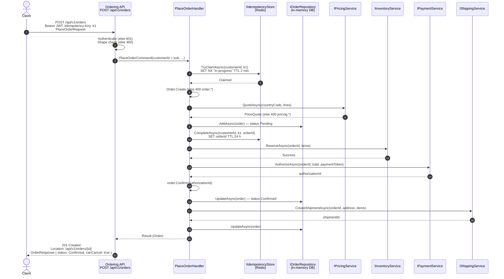
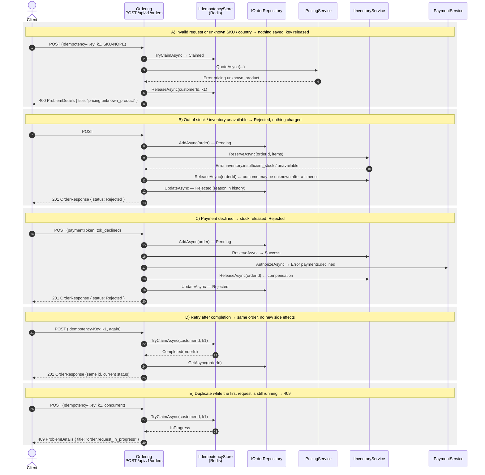
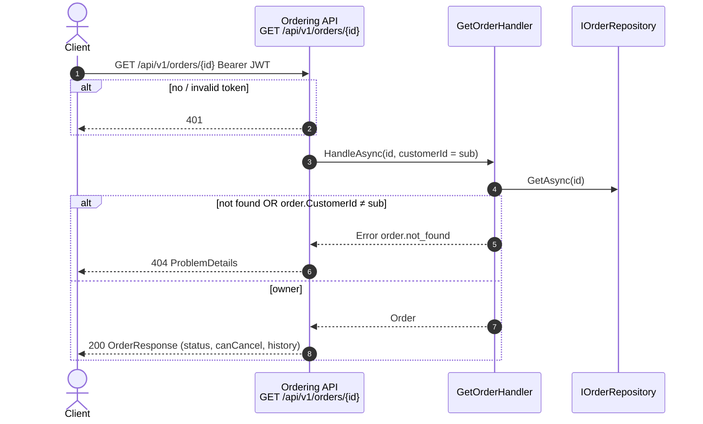
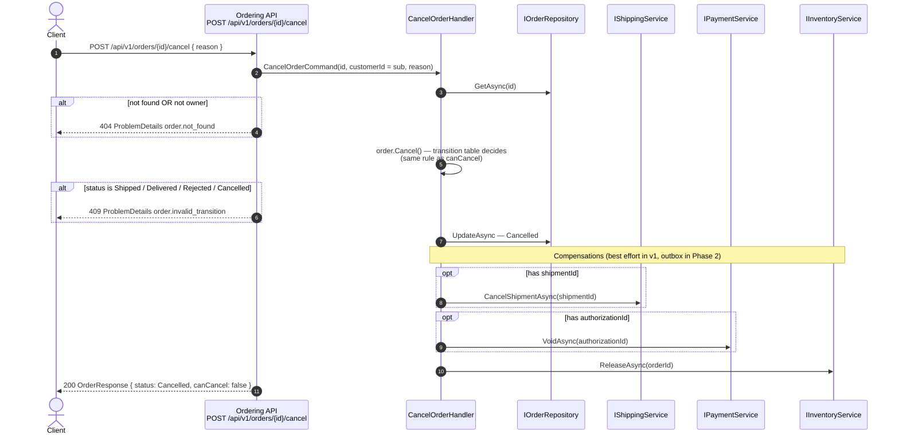
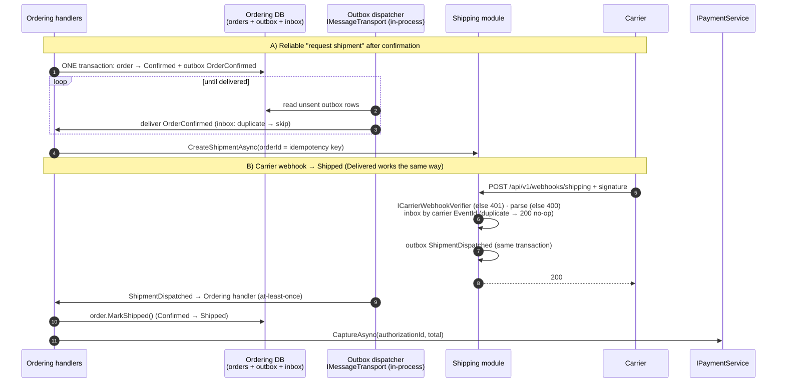

# API flows, contracts and response codes

Flows §5–§8 match the current code. §9 is Phase 2: its contracts are in code, its implementation is not.

## 1. Endpoints at a glance

Order endpoints require `Authorization: Bearer <JWT>`. The customer id is the token's `sub` claim, never the body. The API is versioned in the path (`/api/v1`). A breaking change becomes `/api/v2`, served alongside v1.

| Method | Route | Request | Success | Errors |
|---|---|---|---|---|
| `POST` | `/api/v1/orders` | `PlaceOrderRequest` + optional `Idempotency-Key` header | **201** `OrderResponse` + `Location` (status `Confirmed` **or** `Rejected`) | 400, 401, 409, 500 |
| `GET` | `/api/v1/orders/{id}` | — | **200** `OrderResponse` | 401, 404, 500 |
| `POST` | `/api/v1/orders/{id}/cancel` | `CancelOrderRequest` (optional) | **200** `OrderResponse` (status `Cancelled`) | 401, 404, 409, 500 |
| `POST` | `/api/v1/webhooks/shipping` *(Phase 2)* | Carrier payload + signature header | **200** | 400, 401 |
| `GET` | `/health/live` | — | **200** process is up | — |
| `GET` | `/health/ready` | — | **200** Redis reachable | **503** not ready |
| `GET` | `/openapi/v1.json` | — | **200** (Development only) | — |

## 2. Response codes

| Code | When | Body |
|---|---|---|
| **200** | Read or cancel succeeded | `OrderResponse` |
| **201** | Order **processed**. Check `status`: `Confirmed` or `Rejected` (out of stock, declined, provider unavailable). An idempotent replay also returns 201 with the original order. | `OrderResponse` |
| **400** | Malformed request (missing address field, lines or payment token; `Idempotency-Key` empty or over 64 characters), or business validation failed (no lines, quantity ≤ 0, duplicate SKU, unknown SKU, unsupported country). Nothing saved. | ProblemDetails |
| **401** | Missing, expired or invalid token (or invalid webhook signature) | empty |
| **404** | Order does not exist **or belongs to another customer** (no id probing) | ProblemDetails |
| **409** | `order.request_in_progress`: same `Idempotency-Key` still running. `order.invalid_transition`: e.g. cancelling a `Shipped`, `Rejected` or `Cancelled` order | ProblemDetails |
| **500** | Unexpected fault (bug, or Redis down when a key is sent). No stack trace. | ProblemDetails with `traceId` |
| **503** | `/health/ready` only: a dependency is unreachable | — |

## 3. HTTP contracts

```jsonc
// PlaceOrderRequest — POST /api/v1/orders
// Header (optional): Idempotency-Key: <client-generated unique string>
{
  "shippingAddress": { "line1": "1 Main St", "city": "Athens", "postalCode": "10552", "countryCode": "GR" },
  "lines": [ { "sku": "SKU-KEYBOARD", "quantity": 1 }, { "sku": "SKU-MOUSE", "quantity": 2 } ],
  "paymentToken": "tok_visa"            // provider-issued token, never card data; no prices in the request
}
```

```jsonc
// CancelOrderRequest — POST /api/v1/orders/{id}/cancel   (body optional)
{ "reason": "Changed my mind" }
```

```jsonc
// OrderResponse — 200 / 201
{
  "id": "01a108ee-58d0-7ee5-be08-52c63c99b066",
  "status": "Confirmed",                // Pending | Confirmed | Rejected | Cancelled | Shipped | Delivered
  "canCancel": true,                    // from the transition table: true only for Pending / Confirmed
  "lines": [
    { "sku": "SKU-KEYBOARD", "quantity": 1,
      "unitPrice": { "amount": 49.90, "currency": "EUR" }, "lineTotal": { "amount": 49.90, "currency": "EUR" } }
  ],
  "totals": {
    "subtotal": { "amount": 89.70, "currency": "EUR" },
    "charges":  [ { "code": "shipping", "amount": { "amount": 4.90, "currency": "EUR" } } ],
    "tax":      { "amount": 22.70, "currency": "EUR" },
    "total":    { "amount": 117.30, "currency": "EUR" }
  },
  "history": [                          // lifecycle tracking
    { "status": "Pending",   "at": "2026-10-05T10:00:00Z", "reason": "Order received" },
    { "status": "Confirmed", "at": "2026-10-05T10:00:01Z", "reason": "Stock reserved and payment authorized" }
  ]
}
```

```jsonc
// ProblemDetails (RFC 9457) — every 4xx/5xx with a body
{
  "type": "https://tools.ietf.org/html/rfc9110#section-15.5.10",
  "title": "order.invalid_transition",  // stable, machine-readable error code
  "status": 409,
  "detail": "An order cannot move from Shipped to Cancelled.",
  "traceId": "00-7e29d597b8342c29a0f8bc2bdd268811-840ff89f7b306a64-01"
}
```

## 4. Module contracts and internal ports

Cross-module contracts (public, in each module's `Contracts/`):

| Module | Contract | Operations | Errors returned |
|---|---|---|---|
| Pricing | `IPricingService` | `QuoteAsync(PriceQuoteRequest) → PriceQuote` | `pricing.no_lines`, `pricing.unknown_product`, `pricing.unsupported_country` |
| Inventory | `IInventoryService` | `ReserveAsync(orderId, StockItem[])`, `ReleaseAsync(orderId)` | `inventory.insufficient_stock`, `inventory.unavailable` |
| Payments | `IPaymentService` | `AuthorizeAsync(orderId, Money, token) → authorizationId`, `CaptureAsync(authorizationId, Money)`, `VoidAsync(authorizationId)` | `payments.declined` |
| Shipping | `IShippingService` | `CreateShipmentAsync(ShipmentRequest) → shipmentId`, `CancelShipmentAsync(shipmentId)` | provider errors |
| Shipping | Events | `ShipmentDispatched`, `ShipmentDelivered` (Phase 2) | — |
| Ordering | Events | `OrderConfirmed`, `OrderRejected`, `OrderCancelled` (Phase 2, external consumers) | — |

`orderId` is the idempotency key for every call to an external system.

Ports inside Ordering (internal):

| Port | Operations | Backed by |
|---|---|---|
| `IIdempotencyStore` | `TryClaimAsync → Claimed / InProgress / Completed(orderId)`, `CompleteAsync`, `ReleaseAsync` | **Redis** |
| `IOrderRepository` | `GetAsync`, `AddAsync`, `UpdateAsync` | In-memory DB → PostgreSQL / SQL Server (ADR-006) |

**Idempotency key states** (Redis key `ordering:idempotency:{customerId}:{key}`):

| State | Meaning | Response |
|---|---|---|
| absent → `SET NX "in-progress"` (TTL 2 min) succeeds | This request does the work | normal flow |
| `"in-progress"` | Same key, first request still running | **409** `order.request_in_progress` |
| `<orderId>` (TTL 24 h) | Already done | **201** with the original order |
| deleted | Request failed validation before an order existed | client may fix it and reuse the key |

## 5. Place order — happy path → 201 Confirmed



## 6. Place order — failure paths



## 7. Get order



## 8. Cancel order



## 9. Phase 2 — shipment webhooks and outbox

Phase 2 closes two gaps with one mechanism.
- **Reliable follow-up steps.** Confirmation and the "request shipment" step are saved together through the **outbox** and retried until delivered. Duplicates are skipped by the **inbox**.
- **Shipped / Delivered.** Shipping verifies and translates the carrier's webhook into **its own** event, and Ordering subscribes. The dependency stays Ordering → Shipping (ADR-003).

The outbox and inbox are tables in each module's database, not Redis or RabbitMQ (ADR-005, ADR-008). The transport is in-process; RabbitMQ implements `IMessageTransport` only when a module is extracted.



**Webhook responses:** **200** for processed *and* duplicate events (so the carrier stops retrying), **401** bad signature, **400** unparsable payload. A 5xx makes the carrier retry, which is safe because of the inbox.

**Contracts already in code:** [Messaging.cs](../src/SomeCompany.OrderProcessing.SharedKernel/Messaging.cs) (`IIntegrationEvent`, `IOutbox`, `IMessageTransport`, `IInbox`, `IIntegrationEventHandler<T>`), [OrderIntegrationEvents.cs](../src/Modules/SomeCompany.OrderProcessing.Ordering/Contracts/OrderIntegrationEvents.cs), [ShipmentIntegrationEvents.cs](../src/Modules/SomeCompany.OrderProcessing.Shipping/Contracts/ShipmentIntegrationEvents.cs), [CarrierWebhook.cs](../src/Modules/SomeCompany.OrderProcessing.Shipping/CarrierWebhook.cs), `IPaymentService.CaptureAsync`, `Order.MarkShipped` / `MarkDelivered`.
