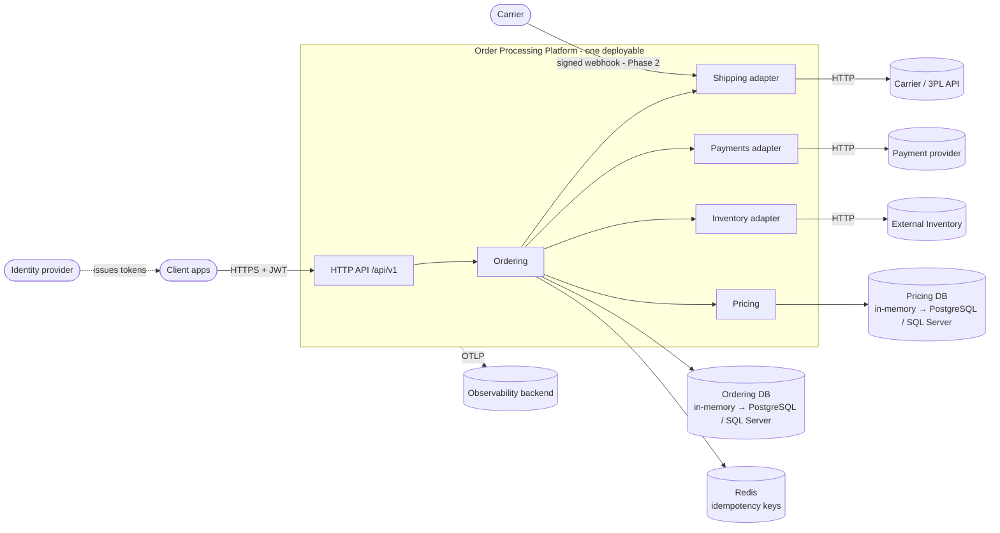
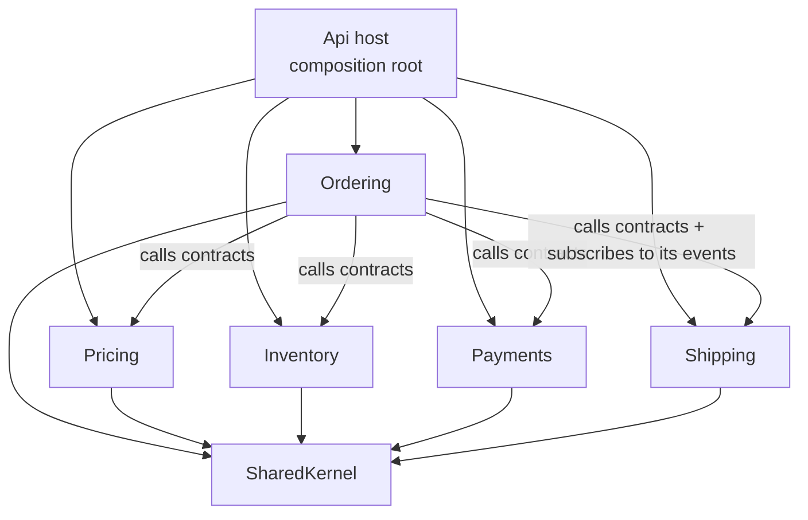
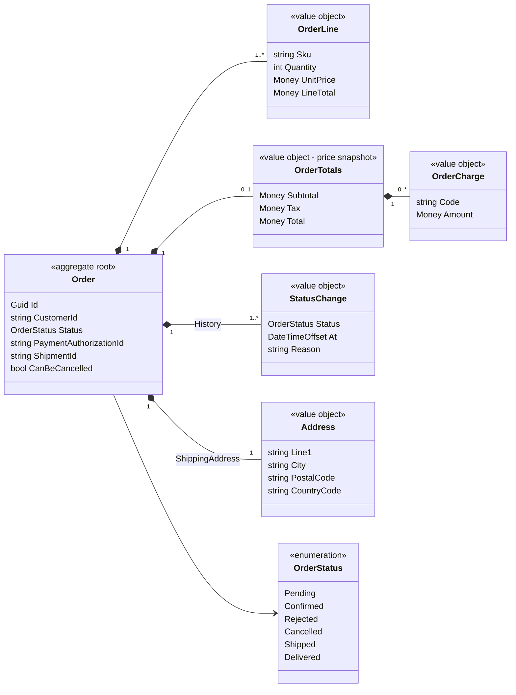
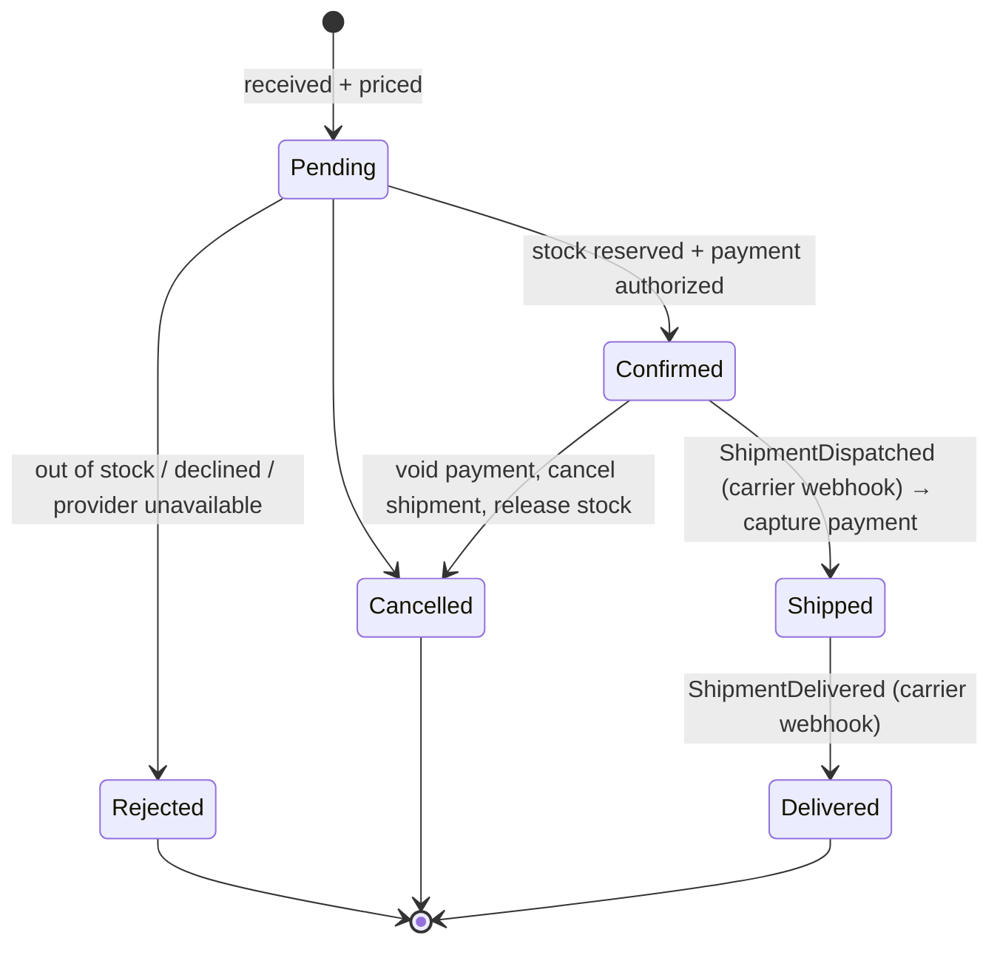
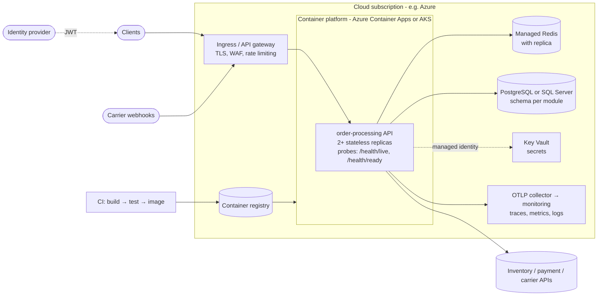

# Architecture

## 1. Scope and assumptions

The Order Processing Platform **owns orders and pricing**. It **delegates** stock, money movement and delivery to external systems.

Assumptions (to validate with the business):

- Clients (web shop, mobile app, partner systems) call one HTTP API with a JWT from the company identity provider. The `sub` claim is the customer id.
- One currency per order. Placeholder data uses EUR.
- Prices, tax rates and stock levels are **never** taken from the client.
- External inventory, payment and shipping providers expose HTTP APIs, accept an idempotency key, and the carrier can send signed webhooks.

**Open questions for the business** (answers may change ADRs; none blocks Phase 1):

| Question | Affects |
|---|---|
| Partial fulfilment or split shipments allowed, or all-or-nothing? | Reservation contract, lifecycle (ADR-004) |
| How long may stock stay reserved for a Pending order? | Sweeper timeout, provider reservation TTL |
| On provider outage: reject immediately, or keep Pending and retry? | ADR-004 |
| Expected peak orders/minute and latency target for `POST`? | Sync vs async placement, scaling |

## 2. System context



## 3. Modules

| Module | Responsibility | Public contract | Talks to |
|---|---|---|---|
| **Ordering** | Order aggregate and lifecycle; orchestrates placement and cancellation; idempotency; HTTP endpoints | Events `OrderConfirmed` / `OrderRejected` / `OrderCancelled` (for external consumers, Phase 2) | Contracts of the four modules below; Redis |
| **Pricing** | Unit prices → subtotal → charges → tax → total | `IPricingService` | Its own in-memory DB |
| **Inventory** | Anti-corruption layer over the external inventory: reserve and release stock | `IInventoryService` | External inventory API |
| **Payments** | Adapter over the payment provider: authorize, capture, void | `IPaymentService` | Payment provider |
| **Shipping** | Adapter over the carrier: create and cancel shipments; verifies and translates carrier webhooks | `IShippingService`; events `ShipmentDispatched` / `ShipmentDelivered` | Carrier API and webhooks |
| **SharedKernel** | `Result`, `Error`, `Money`, messaging interfaces | — | — |

**Rules (enforced by `ModuleBoundaryTests`):**

1. A module's only public types are its `*.Contracts` namespace and its `XxxModule` registration class. Everything else is `internal`.
2. Dependencies point one way: **Ordering → supporting modules**. Supporting modules never reference Ordering or each other. When they need to report back, they publish their own events, which Ordering subscribes to (ADR-003, ADR-008).
3. Contracts use their own types (e.g. `ShippingAddress`), not Ordering's, so each module evolves its model independently.



### Data ownership: one database per module

No module reads another module's data. **In the PoC every database is in-memory. During development they will be changed to PostgreSQL or SQL Server** (EF Core, one schema and `DbContext` per module) behind the same ports, without changing any handler (ADR-006).

| Module | Owns | PoC storage | Target |
|---|---|---|---|
| Ordering | Orders, lines, price snapshot, status history (+ outbox/inbox in Phase 2) | `InMemoryOrderRepository` | PostgreSQL / SQL Server, `ordering` schema |
| Ordering | Idempotency keys (short-lived, shared by all instances) | **Redis** | Managed Redis |
| Pricing | Product prices, tax rates | `InMemoryProductCatalog`, `InMemoryTaxRateProvider` | `pricing` schema, or external catalogue / tax engine |
| Shipping | Nothing in the PoC (carrier is the source of truth) | — | Inbox/outbox tables for webhooks (Phase 2) |
| Inventory, Payments | Nothing (provider is the source of truth) | — | — |

## 4. Order model



Behaviour (`Create`, `ApplyPricing`, `Confirm`, `Reject`, `Cancel`, `MarkShipped`, `MarkDelivered`) and invariants live in the aggregate. An order has at least one line, quantities are positive and SKUs are unique. It must be priced before it can be confirmed. Every status change goes through one transition table and is appended to `History`.

## 5. Order lifecycle



- The whole state machine is one table, `Order.AllowedTransitions`. `CanBeCancelled` reads the same table and is returned to clients as `canCancel`.
- **Cancellation is allowed only before shipment.** After that it becomes a return (future process).
- `Shipped` and `Delivered` are driven by carrier webhooks. The contracts are in code; the wiring comes in Phase 2 ([api-flows.md §9](api-flows.md#9-phase-2--shipment-webhooks-and-outbox)).

## 6. Placing an order

1. Claim the `Idempotency-Key` in Redis. Already done → return that order. Still running → **409**.
2. Create the order (invariants) and price it through `IPricingService`. Invalid → **400**, key released, nothing saved.
3. Save the order as **Pending**, then link the idempotency key to it.
4. Reserve stock (`IInventoryService`). Failure → **Rejected**.
5. Authorize payment (`IPaymentService`). Failure → release stock → **Rejected**.
6. **Confirm**, then request a shipment (`IShippingService`).
7. Return **201** with the order: `Confirmed` or `Rejected` (ADR-004).

Why this order: pricing has no side effects, so it goes first. Stock is reserved before payment, so we never charge for goods we cannot ship. The order is saved before any external side effect, so every reservation and authorization belongs to a visible order. **Sequence diagrams for every path, with contracts and response codes, are in [api-flows.md](api-flows.md).**

## 7. Failure handling (v1)

| What fails | Outcome | Status |
|---|---|---|
| Invalid request / unknown SKU / unsupported country | 400, nothing saved, idempotency key released | ✅ handled |
| Out of stock / payment declined | Order **Rejected**; stock released if it was reserved; nothing charged | ✅ handled |
| Provider unavailable (retries exhausted, circuit open, timeout) | Mapped to `*.unavailable` → order **Rejected** (fail fast, ADR-004) | ✅ v1 trade-off |
| Reservation outcome unknown (timeout after the provider reserved) | Release is always called after a failed reserve (idempotent) | ✅ handled, tested |
| Customer cancels while the order is being placed | Confirmation refused; payment voided, stock released; order stays **Cancelled** | ✅ handled, tested |
| Provider slow or flaky | Retry + timeout + circuit breaker (Inventory adapter is the template) | ✅ handled |
| Client retries / sends duplicates concurrently | Same order / **409** while the first request is running | ✅ handled |
| Client disconnects mid-flow | Workflow still completes (`CancellationToken.None` after save) | ✅ handled |
| Redis down | Readiness 503 (no traffic); requests with a key → 500, never duplicates | ✅ by design |
| Shipment request or cancel-compensation fails | Logged, **no retry** | ⚠️ gap → outbox (Phase 2) |
| Process crashes mid-placement | Order stuck in **Pending** | ⚠️ gap → sweeper (Phase 2) |

## 8. Deployment view



| Environment | Runs | External systems | Data |
|---|---|---|---|
| **Local** | `dotnet run` + `docker compose` (Redis) | Fakes (no `Inventory:BaseUrl`) | In-memory DBs, local Redis, `dotnet user-jwts` tokens |
| **Dev / Test** | Container platform, 1–2 replicas | Provider **sandboxes** | Real DB (after Phase 1), managed Redis |
| **Production** | 2+ replicas, autoscaling on CPU and request rate | Live providers | Managed DB with backups, Redis with replica |

**Configuration.** Secrets (Redis and DB connection strings, provider keys, webhook signing secret) come from **Key Vault** via managed identity and never sit in the repo. Everything else is environment configuration:
- `ConnectionStrings:Redis` (**required**)
- `Inventory:BaseUrl` (empty = fake, local only)
- `Authentication:Schemes:Bearer:*` (identity provider)
- `OTEL_EXPORTER_OTLP_ENDPOINT` (enables telemetry export)

Release flow: CI builds, runs the tests and builds one image. The **same image** is promoted from dev to test to prod. In Phase 1, DB migrations run as a pipeline step before rollout. Readiness probes gate traffic during rolling updates.

## 9. Non-functional requirements

| Concern | How the design addresses it now | Next step |
|---|---|---|
| **Modularity** | One project per module; `internal` by default; public `Contracts` only; one-way dependencies | — |
| **Maintainability** | Small modules, plain handlers, state machine in one table, short ADRs | — |
| **Testability** | Pure domain; hand-stubbed contracts; injected `TimeProvider`; 26 tests (domain, placement, cancellation, idempotency, pricing, boundaries) in < 1 s, no infrastructure needed | API integration tests (`WebApplicationFactory` + Testcontainers) |
| **Scalability** | Stateless API (idempotency in Redis) → horizontal scale; modules extractable | Real DB, read model for queries, extract hot modules |
| **Reliability** | Reserve-before-charge, compensations, idempotency at every hop, resilience pipeline, save-before-side-effects, readiness gating | Outbox/inbox (contracts in code), Pending sweeper |
| **Security** | JWT on all order endpoints, customer id from the token; another customer's order → 404 (no id probing); payment tokens only (out of PCI-DSS scope); server-side prices; signed webhooks (contract); no stack traces | Back-office policies, Key Vault, rate limiting |
| **Observability** | OpenTelemetry traces/metrics/logs (vendor-neutral OTLP; one trace spans provider calls); `traceId` in every error; `/health/live` + `/health/ready` (Redis) | Business metrics, dashboards, alerts |
| **Deployment** | One container image, CI, `docker compose` for local Redis, deployment view above | IaC (Bicep/Terraform), pipeline with migrations |
| **Extensibility** | `IChargeRule`, `ITaxRateProvider`, adapters behind contracts, integration events, `/api/v1` versioning | New consumers via the outbox |

## 10. Solution layout

```
src/
  SomeCompany.OrderProcessing.Api/            host: Program.cs (composition root), config, orders.http
  SomeCompany.OrderProcessing.SharedKernel/   Result, Error, Money, Messaging (interfaces only)
  Modules/
    SomeCompany.OrderProcessing.Ordering/     Contracts/ (events)  Domain/  Application/  Infrastructure/ (in-memory DB, Redis)  Api/
    SomeCompany.OrderProcessing.Pricing/      Contracts/  PricingService (pipeline)  ports + InMemoryPricingData
    SomeCompany.OrderProcessing.Inventory/    Contracts/  InventoryApiClient (real adapter)  FakeInventoryService
    SomeCompany.OrderProcessing.Payments/     Contracts/  FakePaymentService
    SomeCompany.OrderProcessing.Shipping/     Contracts/ (service + events)  CarrierWebhook (contracts)  FakeShippingService
tests/
  SomeCompany.OrderProcessing.UnitTests/           Ordering/ (state machine, placement, cancellation, idempotency; TestDoubles.cs)
                                                   Pricing/ (charges, threshold, tax, errors)
  SomeCompany.OrderProcessing.ArchitectureTests/   module boundary rules
```

## 11. Deliberately out of scope

Real databases (in-memory per module for now, ADR-006), outbox/inbox and webhook implementations (contracts only), message broker (ADR-008), event sourcing, IaC, back-office endpoints, returns, multi-currency, order listing. Each is either planned in [implementation-plan.md](implementation-plan.md) or not needed until a concrete requirement appears.
